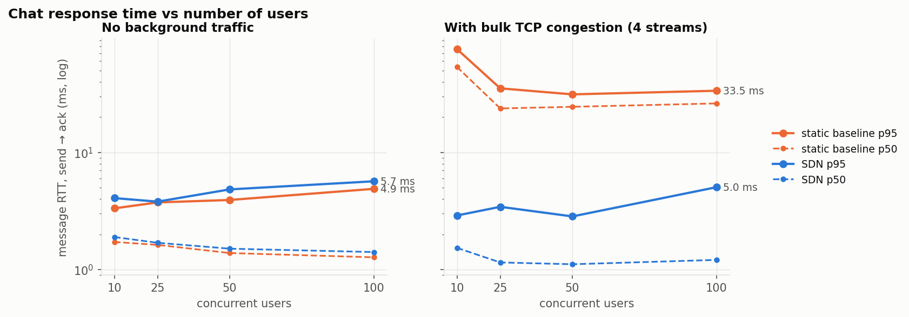
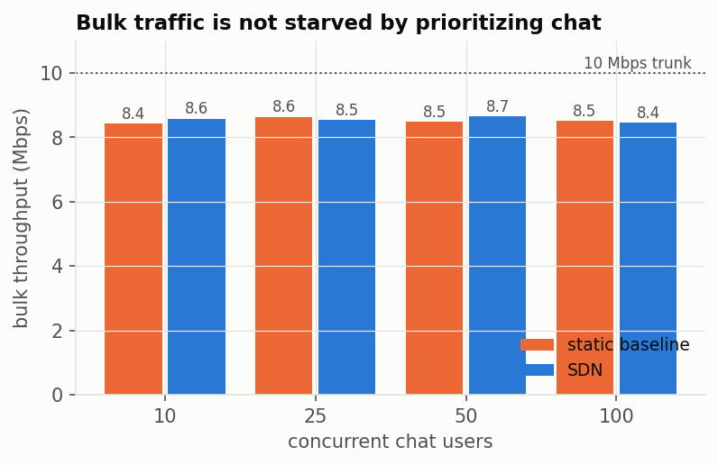
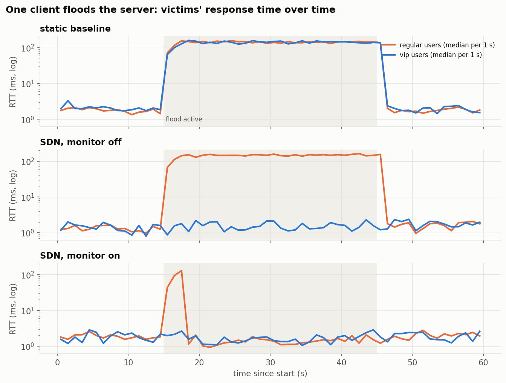
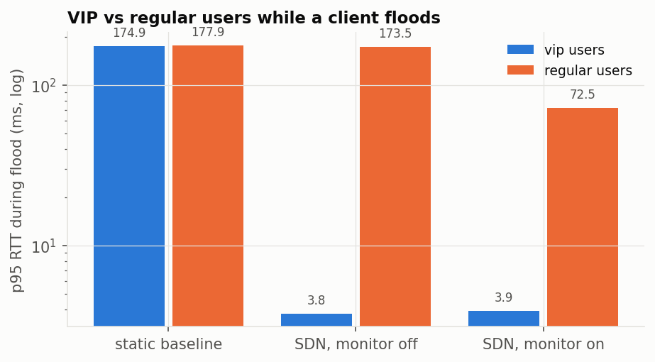
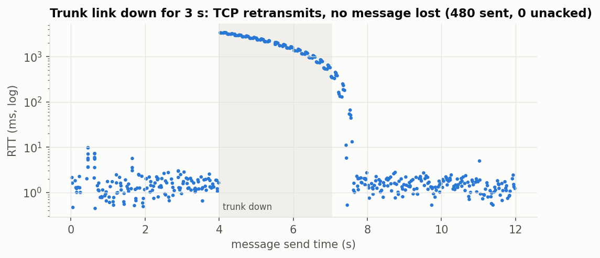

# Multi-Client Chat Network with SDN

Computer Networks mini-project (Project 8, SDN + socket programming).
A multi-client chat application over raw TCP sockets, running in a Mininet
network whose OpenFlow switches are programmed by a Ryu controller. The chat
server reports application events (login, room join/leave, logout) to the
controller. The controller turns them into per-connection traffic classes and
re-programs the switches: VIPs get a high-priority queue, bulk traffic goes to
a low one, floods are detected and demoted, and blocked users are dropped in
the network.

## Contents

- [Architecture](#architecture)
- [Repository layout](#repository-layout)
- [VM setup](#vm-setup)
- [Running the demo](#running-the-demo)
- [Live traffic UI](#live-traffic-ui)
- [Tests](#tests)
- [Experiments](#experiments)
- [Results](#results)
- [Limitations](#limitations)

## Architecture

```
            10.0.0.11..14                                  10.0.0.1:5000
  c1 c2 c3 c4 ──┐                                    ┌── srv   (chat server)
                ├── s1 ════ 10 Mbps trunk ════ s2 ───┤
  bulk ─────────┘   (bottleneck, 3 HTB queues        └── sink  (bulk traffic sink)
  10.0.0.100          on every switch port)              10.0.0.2
                 \                                  /
                  └──── Ryu controller (OpenFlow 1.3, :6653, REST :8080) ────┘
                                    ▲
     chat server ── login/join/leave/logout + client ip:port ──┘
                    (Unix datagram socket /tmp/chat_sdn_events.sock)
```

**Communication flow.** Clients never talk to each other directly. A client
sends a request to the server over its TCP connection. The server forwards
messages by username (PM) or room (fan-out to all members) using its own
session table, and acks the sender. The switches forward packets according to
flows installed by the controller:

1. A new TCP connection's first packet misses in the flow table and goes to
   the controller (packet-in). The controller installs a 5-tuple flow with
   `set_queue` for the connection's current class (NORMAL before login).
2. On login, the server sends `{"event":"login","user":"vip_bob","client_ip":...,"client_port":...}`.
3. The controller looks up that connection, computes its class from
   `sdn/policy.json` (user tier, joined rooms, block list, flood state), and
   re-sends flow-mods with the new queue on every switch the connection crosses.
4. Every second it polls flow statistics. A connection sending > 2 Mbps for
   2 s is demoted to the LOW queue, and restored when it calms down.

| class | queue | who |
|---|---|---|
| HIGH | 1 | `admin`, `vip_*`, members of `announcements` / `ops` |
| NORMAL | 2 | regular users, pre-login, ICMP |
| LOW | 3 | bulk TCP/UDP, `guest_*`, demoted flooders |

Details: [docs/protocol.md](docs/protocol.md) (wire protocol and events),
[docs/controller_design.md](docs/controller_design.md) (flow table,
classification, monitor, REST).

## Repository layout

```
chat/       protocol.py (JSON-lines framing), server.py, client.py (library + CLI), notifier.py
sdn/        controller.py (Ryu app + REST), policy.py (decision logic, no Ryu), policy.json
topo/       topology.py (Mininet + OVS QoS, demo mode), mx.sh (run a command in a host)
experiments/ load_client.py, bulk.py, run_experiments.py, robustness.py, plot.py, common.py
tests/      unit + integration tests, mininet_check.py (end-to-end on the real network)
ui/         server.py + index.html + traffic.py: one-button traffic demo in the browser
docs/       protocol, controller design, demo script, demo commands, test cases, viva notes
results/    CSV summaries, plots/, raw/ (per-run JSON and logs)
```

The chat app, load tools and topology use only the Python standard library
(Python 3.8+). The controller needs Ryu. Plots need matplotlib.

## VM setup

Tested on Ubuntu 26.04 (VirtualBox, 2 vCPU) with Mininet 2.3.0, Open vSwitch
3.7.1, Ryu 4.34. Ryu is unmaintained and does not run on Python ≥ 3.10, so it
gets its own Python 3.9 virtualenv. Everything else uses the system `python3`.

```bash
# 1. Mininet + Open vSwitch
sudo apt update
sudo apt install -y mininet openvswitch-switch openvswitch-testcontroller python3-venv
sudo systemctl enable --now openvswitch-switch
sudo mn --switch ovsbr --test pingall          # expect 0% dropped

# 2. Ryu in a Python 3.9 venv (uv provides 3.9 on any Ubuntu)
curl -LsSf https://astral.sh/uv/install.sh | sh && source ~/.bashrc
uv python install 3.9
uv venv --python 3.9 --seed ~/ryu-venv
~/ryu-venv/bin/pip install "setuptools==67.6.1" wheel pbr
~/ryu-venv/bin/pip install --no-build-isolation ryu==4.34 eventlet==0.30.2
~/ryu-venv/bin/ryu-manager --version           # ryu-manager 4.34

# 3. matplotlib for plots (either one)
sudo apt install -y python3-matplotlib         # or: uv run --with matplotlib ...
```

Why the pins: newer setuptools breaks Ryu's `setup.py`, `pbr` must be present
when build isolation is off, and eventlet > 0.30.2 removed `ALREADY_HANDLED`,
which Ryu imports. On Ubuntu 20.04 (Python 3.8), a plain
`python3 -m venv` + `pip install ryu eventlet==0.30.2` also works.

> **Gotcha:** `sudo mn -c` kills any running `ryu-manager`. Always clean up
> *before* starting the controller.
>
> **Gotcha:** if the controller exits with `cannot remove stale event socket`,
> an earlier run as root left `/tmp/chat_sdn_events.sock` behind. Run
> `sudo rm -f /tmp/chat_sdn_events.sock` (the experiment scripts clean it up themselves).

## Running the demo

```bash
cd ~/Desktop/CN-Mini-Project
sudo mn -c
~/ryu-venv/bin/ryu-manager sdn/controller.py              # terminal 1
sudo python3 topo/topology.py demo                        # terminal 2: network + server + pingall + CLI
sudo topo/mx.sh c1 python3 chat/client.py --user alice   --password pw1234 --register   # terminal 3
sudo topo/mx.sh c2 python3 chat/client.py --user vip_bob --password pw1234 --register   # terminal 4
sudo ovs-ofctl -O OpenFlow13 dump-flows s1 | grep priority=100     # alice queue 2, vip_bob queue 1
curl -s localhost:8080/chat/state | python3 -m json.tool
```

Client commands: `/register`, `/login`, `/join ROOM`, `/leave ROOM`,
`/room ROOM`, `/pm USER TEXT`, `/rooms`, `/users`, `/ping`, `/quit`. Plain text
goes to the current room.

Admin (REST, port 8080):
```bash
curl -s -XPOST localhost:8080/policy/block   -d '{"user":"alice"}'
curl -s -XPOST localhost:8080/policy/unblock -d '{"user":"alice"}'
curl -s -XPOST localhost:8080/mode -d '{"mode":"static"}'          # baseline
curl -s -XPOST localhost:8080/mode -d '{"mode":"sdn","monitor":true}'
curl -s -XPOST localhost:8080/policy/reload                        # after editing policy.json
```

The full rehearsed demo, with what to point at, is in
[docs/demo_script.md](docs/demo_script.md). Topology alone:
`sudo python3 topo/topology.py check` (build, pingall, print tc classes, exit).

## Live traffic UI

A small web page that starts and stops real chat traffic and shows the user and
room policies working. It needs the normal demo running (controller in terminal 1,
`topology.py demo` in terminal 2). Then, in a third terminal:

```bash
sudo python3 ui/server.py          # open http://127.0.0.1:8000 in the VM's browser
```

- **Start / Stop traffic:** 8 simulated users chat from c1-c3: 2 VIP (`vip_*`),
  3 regular, 1 regular user who joins the `announcements` room, and 2 guests
  (`guest_*`). The optional bulk transfer fills the 10 Mbps trunk, which is what
  makes priority visible.
- **Per class (HIGH / NORMAL / LOW):** number of users, median and p95 round-trip
  time over the last 5 s, and the throughput of that queue on the trunk (`tc`).
- **Per user:** why the policy chose that class (name rule, room rule), the class and
  queue the controller actually applied, and the measured RTT.
- **SDN priority / Static baseline** switches the controller mode live. **Controller
  log** lists every class change, block, flood demotion and mode change.

Expected result with bulk traffic on: in SDN mode HIGH and NORMAL stay at about
1 ms while LOW (guests, sharing queue 3 with the bulk transfer) rises to 50-60 ms;
in static mode all users share queue 2 and sit at about 55 ms. Without bulk traffic
all classes are about 1 ms, because priority only matters when the link is full.
Blocking a user with the REST call shows up as `DROP` and *stalled*.

The page only offers start/stop and the mode switch, listens on 127.0.0.1 and
rejects POSTs from other websites. Its stats files live in `/tmp/chat_ui`.

## Tests

```bash
python3 -m unittest discover -s tests -t .                   # 50 tests: protocol, server, policy (controller tests skipped)
~/ryu-venv/bin/python -m unittest discover -s tests -t .     # all 68, incl. controller with a stub datapath
sudo python3 tests/mininet_check.py                          # 15 end-to-end checks on the real network
sudo python3 experiments/robustness.py                       # block + link-failure scenarios
```

`mininet_check.py` starts the controller, builds the topology and verifies:
pingall; chat across the network; the controller learning the user from the
login event; 4 chat flows per connection; chat in queue 2, bulk in queue 3 and
VIP in queue 1 by both flow tables **and** tc byte counters; bulk capped by the
10 Mbps trunk; block → drop flow and unblock; static mode → everything in
queue 2. The manual test-case table is in [docs/test_cases.md](docs/test_cases.md).

## Experiments

```bash
sudo python3 experiments/run_experiments.py all      # ≈15 min: scaling + flood
sudo python3 experiments/robustness.py               # ≈2 min
uv run --no-project --with matplotlib python experiments/plot.py   # results/plots/*.png
```

The runner starts its own controller, then for each user count builds the
network and runs every variant: it switches the controller mode over REST,
starts a fresh chat server, optionally starts bulk congestion and waits for it
to ramp, then runs the load generator on c1–c4.

- **Load:** N users split over 4 client hosts, 20 % `vip_*`, rooms of 10, each
  user sends 2 msgs/s (≈120 B) for 20 s. Measured: send→ack RTT per message,
  delivery latency (sender timestamp → receiver; all hosts share one clock),
  connect+login time, messages/s, unacked messages, delivery loss.
- **Variants:** `static` (baseline: same topology, shaping and queues, all
  traffic in queue 2) vs `sdn` (policy + monitor), each with and without
  4-stream bulk TCP from `bulk` to `sink` across the same trunk.
- **Flood:** 20 users plus one abusive client (regular tier) that sends 7 KB
  messages in a tight loop into its own empty room from t = 15 s to 45 s, under
  `static`, `sdn` (monitor off) and `sdn` (monitor on).

## Results

_Filled in from the last full run; see `results/scaling.csv`, `results/flood_summary.csv`, `results/robustness.json`._

All numbers are from one full run on the 2-vCPU VM (2026-10-25). Every run
delivered every message: **0 unacked, 0 % delivery loss, all users OK** in
all 16 scaling runs and 3 flood runs.

### 1. Response time vs users, static baseline vs SDN

Send→ack RTT in ms (p50 / p95 / p99). Load = 2 msgs/s per user.

| users | static, idle | SDN, idle | **static + bulk** | **SDN + bulk** | bulk Mbps static / SDN |
|---|---|---|---|---|---|
| 10  | 1.7 / 3.3 / 5.8 | 1.9 / 4.1 / 6.0 | 53.4 / 75.9 / 102.6 | **1.5 / 2.9 / 4.3** | 8.44 / 8.58 |
| 25  | 1.6 / 3.7 / 7.8 | 1.7 / 3.8 / 7.3 | 23.7 / 35.1 / 57.3  | **1.2 / 3.4 / 8.0** | 8.64 / 8.54 |
| 50  | 1.4 / 3.9 / 7.9 | 1.5 / 4.8 / 8.5 | 24.4 / 31.2 / 40.0  | **1.1 / 2.8 / 4.6** | 8.49 / 8.66 |
| 100 | 1.3 / 4.9 / 8.1 | 1.4 / 5.7 / 8.4 | 26.1 / 33.5 / 355.6 | **1.2 / 5.0 / 8.5** | 8.51 / 8.45 |



**Interpretation.**
- With no congestion, both modes are the same (~1.5 ms median): the policy
  costs nothing when the network is idle.
- With bulk TCP saturating the 10 Mbps trunk, the static baseline puts chat
  in the same FIFO as bulk. Every chat packet waits behind up to 100 queued
  1500-byte packets, so the median goes to 24–53 ms and the 100-user p99 to
  356 ms. SDN puts bulk in queue 3 and chat in queues 1/2, each with its own
  FIFO, and chat stays at idle-network latency (p95 ≤ 5 ms): a **7–26× lower
  p95**.
- Bulk is not starved: it gets 8.4–8.7 Mbps in both modes, because HTB is
  work-conserving and chat needs only a few hundred kbit/s.
- Server throughput scales linearly (20 → 200 acked msgs/s, plus 9× fan-out
  deliveries) with no errors. Delivery latency (sender → other room members)
  tracks RTT within ±0.3 ms (`deliv_p95` in `results/scaling.csv`).
- Connect+login time grows with users (p50 0.1 s at 10 → 1.2–1.5 s at 100).
  It is dominated by PBKDF2 password hashing (100k iterations) competing for
  2 vCPUs, not by the network, and it is the same in both modes.



### 2. Flood (overload) scenario: monitoring and dynamic demotion

20 users (4 VIP) chat while one regular-tier client floods 7 KB messages from
t = 15 s to 45 s, taking ~9.4 Mbps of the 10 Mbps trunk. RTT in ms of messages
sent during the flood:

| variant | regular p50 / p95 | VIP p50 / p95 | controller action |
|---|---|---|---|
| static baseline | 142.1 / 177.9 | 142.0 / 174.9 | none (no policy) |
| SDN, monitor off | 144.5 / 173.5 | **1.4 / 3.8** | VIPs in queue 1 are protected; regular users share queue 2 with the flooder |
| SDN, monitor on | **1.5 / 72.5** | **1.6 / 3.9** | `flooder rate 9.56 Mbps > 2.00 Mbps for 2 polls: demoted to LOW`, then `restored` after the flood |



With the monitor on, regular users' median RTT goes 44 → 94 → 129 ms in the first
3 s of the flood, then drops to ~1.5 ms. The p95 of 72.5 ms comes entirely from
those first ~3 s (2 polls of detection plus flow re-install). After the flood
stops, the flooder is restored to NORMAL after 5 quiet polls. Demotion moves the
flooder rather than punishing it: its throughput stays ~9.4 Mbps in every
variant, because queue 3 borrows idle capacity. It just stops sharing a FIFO
with everyone else.



### 3. Robustness (`results/robustness.json`)

| scenario | result |
|---|---|
| **Unauthorized access (admin block)** | 8 users chat; `user_5` is blocked at t = 5.00 s. Its last ack is at 4.87 s; the other 7 users have 0 unacked. The server reaps the silent session after 21 s (`TCP_USER_TIMEOUT`). A re-login while blocked is dropped on the login event: a message 0.5 s after login times out (a request in the first few ms can still slip through, see Limitations). After unblock, login and chat work. **PASS** |
| **Link failure** | Trunk s1–s2 down from t = 4.0 to 7.0 s during chat at 5 msgs/s per user. TCP retransmits: 480 messages sent, 0 unacked, 0 delivery loss, max RTT 3.4 s for messages sent during the outage, no reconnects. **PASS** |
| **Congestion** | see §1 (bulk TCP saturating the trunk) |
| **Overload** | see §2 (flooding client) |



## Limitations

- **Reactive flow setup.** The first packet of each connection goes to the
  controller once per switch. That is fine for chat, but it adds ~1 ms per new
  connection and puts the controller on the critical path for connection setup.
- **Block race window.** Blocking is enforced in the network, triggered by the
  asynchronous login event. A reply or request within a few ms of a blocked
  user's login can pass before the drop flows land. Requests after that are
  dropped (`robustness.json`). A production system would also refuse the login
  in the server.
- **Silent sessions after a block.** The server sees silence, not a close. It
  reaps the session via keepalive (idle) or `TCP_USER_TIMEOUT` = 20 s
  (unacked data). Until then a re-login is refused as a duplicate login.
- **Single bottleneck, single path.** One trunk, tree topology, no rerouting.
  The link-failure test shows TCP riding out an outage, not failover.
- **Flood detection granularity.** 1 s polls with 2-poll hysteresis mean a
  flood is demoted after ~2–3 s. Shorter polls increase controller load.
- **Rate-based detection only.** A flooder that stays under 2 Mbps, or many
  colluding small senders, is not detected. The thresholds are static policy.
- **Same clock assumption.** Delivery latency relies on Mininet hosts sharing
  the VM's clock. It would need clock sync on real machines.
- **Performance numbers come from a 2-vCPU VM.** Absolute values depend on the
  host; the static vs SDN comparison is what matters.
